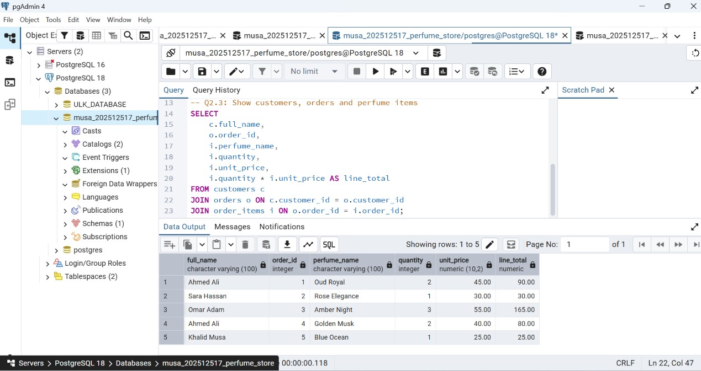

Perfume Store Management System

Assignment III: SQL Practical Exercise – Table Manipulation

Student ID: 202512517
DBMS: PostgreSQL

1. Project Overview

This project manages customers, orders, and perfume items using PostgreSQL.

2. Database Tables

- customers: Stores customer information.
- orders: Stores customer orders.
- order_items: Stores perfume names, quantities, and prices.

3. Relationships

- One customer can have multiple orders.
- One order can contain multiple perfume items.

4. Entity Relationship Diagram (ERD)

"Database ERD" (erd.png)

5. Practical Tasks

The assignment covers SELECT, JOIN, UPDATE, ALTER TABLE, and INSERT statements.

6. Execution Evidence

Screenshots of the SQL statements and their actual execution results will be included in the "screenshots" folder.

7. Conclusion

This project demonstrates database creation, table relationships, data retrieval, data modification, and table structure changes using PostgreSQL.
-- Q2.1: Show orders with customer names
SELECT o.order_id, c.full_name, o.order_date, o.status
FROM orders o
INNER JOIN customers c
    ON o.customer_id = c.customer_id;

-- Q2.2: Show all customers, including those without orders
SELECT c.full_name, o.order_id, o.status
FROM customers c
LEFT JOIN orders o
    ON c.customer_id = o.customer_id;

-- Q2.3: Show customers, orders and perfume items
SELECT
    c.full_name,
    o.order_id,
    i.perfume_name,
    i.quantity,
    i.unit_price,
    i.quantity * i.unit_price AS line_total
FROM customers c
JOIN orders o ON c.customer_id = o.customer_id
JOIN order_items i ON o.order_id = i.order_id;
```

